

# DeepSeek-chan 3D Viewer

**DeepSeek-chan (Whale Maid) & GigaChad DeepSeek CEO (Power Type)**  
360° Interactive 24-FPS Pseudo-3D (Sprite-Stacking) WebGL Viewers

  
  
  
  
  

  <a href="./README.md">🇯🇵 日本語</a> &nbsp;|&nbsp;
  <b>🇺🇸 English</b> &nbsp;|&nbsp;
  <a href="./README.zh-CN.md">🇨🇳 简体中文</a>

---

Each character is packaged as a **zero-dependency, self-contained single HTML file** embedding **9 motions × 24 frames (216 frames total)**, multiple anime facial expressions, an orbiting **3D voxel DeepSeek Logo Whale** with dynamic depth Z-sorting, and 3D particle effects. Open directly in any modern browser over `file://`—no build tools, server, or network requests required.

| Character | Standalone HTML (`file://` ready) | Included Features |
| :--- | :--- | :--- |
| **DeepSeek-chan (Whale Maid)** | [`index.html`](./index.html) | 9 Motions × 24 FPS (216F) · 9 Expressions · 3D Whale Playtime · CEO Thought Bubble · Ocean FX |
| **GigaChad DeepSeek CEO (Power Type)** | [`ceo.html`](./ceo.html) | 9 Power Motions × 24 FPS (216F) · 5 Expressions · Orbiting 3D Logo Whale · Shockwave & Meteor FX |

---

## 1. DeepSeek-chan ([`index.html`](./index.html))

<table>
  <tr>
    <td align="center" width="33%">
      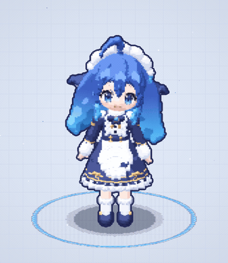 
      <b>360° Turntable (1. IDLE)</b> 
      Flicker-free continuous WebGL rotation
    </td>
    <td align="center" width="33%">
      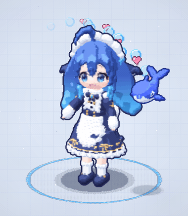 
      <b>7. WHALE (3D Logo Whale Play)</b> 
      Camera-aware Z-sorted 3D whale + hearts & bubbles
    </td>
    <td align="center" width="33%">
      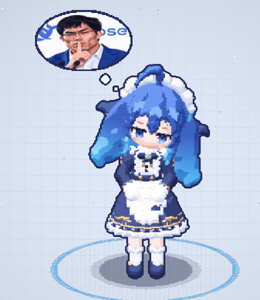 
      <b>6. THINK (CEO Thought Bubble)</b> 
      Deadpan stare + floating overhead CEO meme bubble
    </td>
  </tr>
  <tr>
    <td align="center" width="33%">
      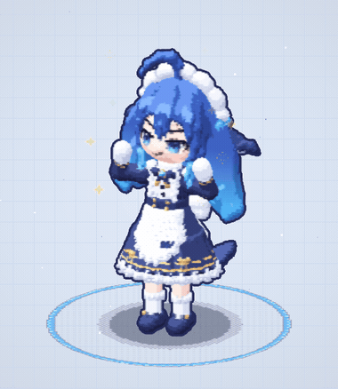 
      <b>5. SHHH (CEO Flex → Shhh!)</b> 
      Smug grin + finger-to-lips pose + sparkles
    </td>
    <td align="center" width="33%">
      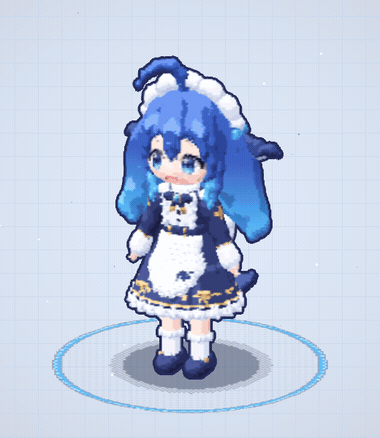 
      <b>8. SPLASH (Ocean Attack I)</b> 
      Cyan crescent slash + 3D water spray & floor ripple
    </td>
    <td align="center" width="33%">
      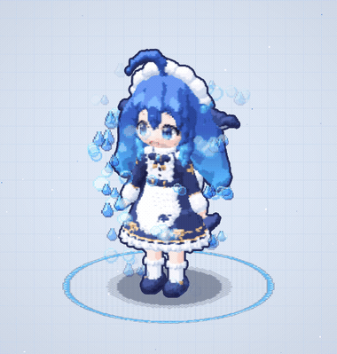 
      <b>9. VORTEX (Ocean Attack II)</b> 
      Levitate charge → deep-sea vortex + triple rings
    </td>
  </tr>
</table>

  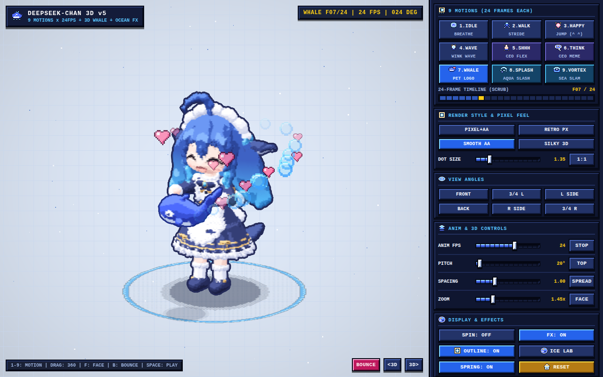

---

## 2. GigaChad DeepSeek CEO ([`ceo.html`](./ceo.html))

Features 9 power-type motions (`1. IDLE` / `2. MARCH` / `3. FLEX` / `4. SHHH` / `5. UPPER` / `6. PUNCH` / `7. SMASH` / `8. RUSH` / `9. AURA`) and 5 expressions (Smirk, Glasses Glint, Glowing-Eye Battle Roar, Shhh Focus, Proud Grin). Driven directly by the unmodified character-agnostic engine from [kuraneko1/anime-pseudo-3d](https://github.com/kuraneko1/anime-pseudo-3d/blob/main/README.en.md).

<table>
  <tr>
    <td align="center" width="33%">
      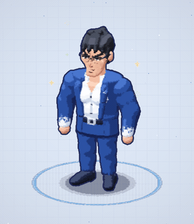 
      <b>3. FLEX (DOUBLE BICEP)</b> 
      Bicep muscle pump vibration + proud grin & sparkles
    </td>
    <td align="center" width="33%">
      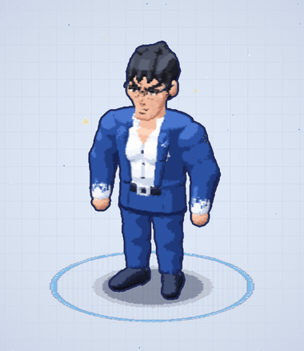 
      <b>4. SHHH (MEWING CEO)</b> 
      Upright index finger across lips + anime glasses glint
    </td>
    <td align="center" width="33%">
      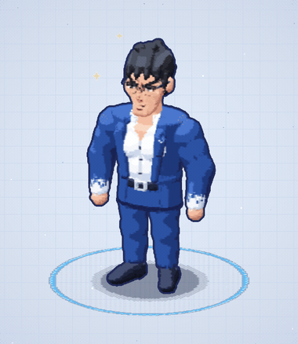 
      <b>5. UPPER (Power Attack I)</b> 
      Glowing-eye roar + leaping Shoryuken & dual rings
    </td>
  </tr>
  <tr>
    <td align="center" width="33%">
      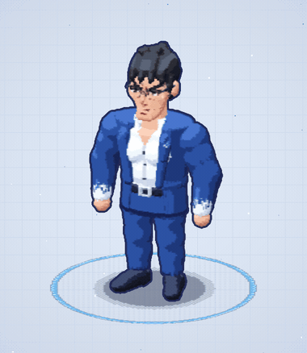 
      <b>6. PUNCH (Power Attack II)</b> 
      Coiled haymaker straight + sonic slash & 3D spray
    </td>
    <td align="center" width="33%">
      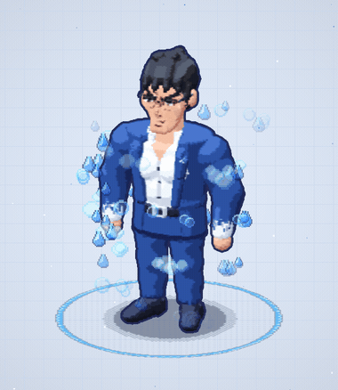 
      <b>7. SMASH (Power Attack III)</b> 
      Leaping meteor ground slam + 3 seismic rings & burst
    </td>
    <td align="center" width="33%">
      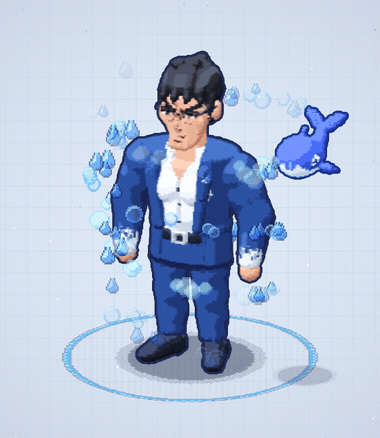 
      <b>9. AURA (DEEPSEEK BOSS)</b> 
      Z-sorted orbiting 3D logo whale + 112-particle vortex
    </td>
  </tr>
</table>

  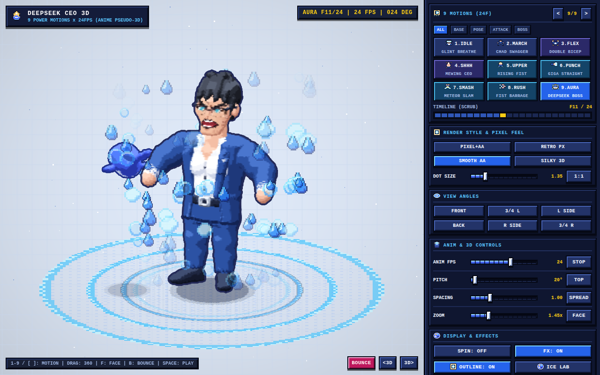

---

## Quick Usage

### How to Open
1. Clone this repository, or download [`index.html`](./index.html) (DeepSeek-chan) / [`ceo.html`](./ceo.html) (GigaChad CEO).
2. Double-click the HTML file to open it in Chrome, Edge, Firefox, or Safari (`file://` offline-ready, zero external network calls).

### Controls

| Input | Action |
| :--- | :--- |
| **Left Drag / Touch Swipe** | Free 360° camera rotation (pauses auto-spin) |
| **Mouse Wheel** | Zoom in / out |
| **Keys `1` – `9`** | Switch between all 9 motions • DeepSeek-chan: `IDLE` / `WALK` / `HAPPY` / `WAVE` / `SHHH` / `THINK` / `WHALE` / `SPLASH` / `VORTEX` • GigaChad CEO: `IDLE` / `MARCH` / `FLEX` / `SHHH` / `UPPER` / `PUNCH` / `SMASH` / `RUSH` / `AURA` |
| **`Space`** | Play / Pause animation |
| **24-FRAME TIMELINE** | Scrub or click any frame to freeze bullet-time and orbit 360° around water slashes, shockwaves, or the 3D whale |
| **`F` / `FACE` Button** | Focus camera close-up on the character's face & expression |
| **`B` / `BOUNCE` Button** | Trigger elastic squash-and-stretch bounce |
| **`Q` / `E` or `←` / `→`** | Rotate left / right smoothly |
| **`R` / `RESET` Button** | Reset to defaults (`PITCH 20°` / `ICE LAB` / `SMOOTH AA`) |

### Visual Customization (Right Panel)
- **RENDER STYLE**: `SMOOTH AA` (default) · `PIXEL+AA` (crisp square pixel grain + smooth edge AA) · `RETRO PX` (classic hard-edge pixel art) · `SILKY 3D` (smooth figurine look) + adjustable `DOT SIZE`
- **3D CONTROLS**: `ANIM FPS` (6–36 FPS) · `PITCH` (true 3D elevation angle `15°`–`90°`, `TOP` overhead view) · `SPACING` (`SPREAD` explodes all 160 stacked slices) · `ZOOM`
- **THEMES & FX**: `ICE LAB` / `DEEP SEA` / `MIDNIGHT` studio themes, `FX: ON/OFF`, `OUTLINE: ON/OFF`, `SPRING: ON/OFF`
- **Portable `.ap3d` Package & Category Filters ([`ceo.html`](./ceo.html))**: Filter motions by category (`ALL` / `BASE` / `POSE` / `ATTACK` / `BOSS`), step with `[` / `]`, and use **`LOAD` / `+MOTION` / `EXPORT`** (or drag-and-drop) to export, load, or merge portable `.ap3d` binary packages offline

---

## Pseudo-3D Engine, Skill & Credits

The character-agnostic WebGL 2-Pass rendering engine and 24-FPS anime pseudo-3D production toolkit behind these viewers are published in a dedicated reusable repository ([`ceo.html`](./ceo.html) runs directly on the unmodified engine):

- **Anime Pseudo-3D Skill & Engine**: [kuraneko1/anime-pseudo-3d](https://github.com/kuraneko1/anime-pseudo-3d/blob/main/README.en.md)
- **Credits & Inspiration**: The core sprite-stacking (layered slice fake-3D pixel art) inspiration and foundational technique are deeply influenced by **[SpriteCook — Sprite stacking for fake 3D pixel art cars and props](https://www.spritecook.ai/blog/sprite-stacking-pixel-art)**. Also builds upon general sprite-stacking techniques from [kuraneko1/sprite-stacking-3d](https://github.com/kuraneko1/sprite-stacking-3d).

---

## License

[MIT License](./LICENSE)
