# DeepSeek-chan 3D Viewer

**DeepSeek ちゃん（クジラメイド）** と **ムキムキ DeepSeek CEO（パワータイプ）** の 360° 回転対応・24 FPS 疑似 3D（スプライトスタッキング）インタラクティブビューワー集です。  
それぞれ単一 HTML ファイルに全 9 モーション × 24 フレーム（計 216 フレーム）・複数表情・3D ボクセル DeepSeek ロゴクジラ・3D パーティクル演出を完全内蔵しており、外部サーバーやインストール不要でブラウザからそのまま動かせます。

| キャラクター | 単体 HTML（`file://` 直開き） | 収録内容 |
| :--- | :--- | :--- |
| **DeepSeek ちゃん（クジラメイド）** | [`index.html`](./index.html) | 9 モーション × 24 FPS（全 216F）・9 表情・3D クジラじゃれ合い・CEO 吹き出し・海洋攻撃 FX |
| **ムキムキ DeepSeek CEO（パワータイプ）** | [`ceo.html`](./ceo.html) | パワー特化 9 モーション × 24 FPS（全 216F）・5 表情・3D 周回クジラロゴ・衝撃波＆メテオ FX |

---

## 1. DeepSeek ちゃん（[`index.html`](./index.html)）

<table>
  <tr>
    <td align="center" width="33%">
      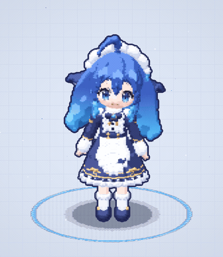 
      <b>360° 回転（1. IDLE）</b> 
      全角度シームレス WebGL 描画
    </td>
    <td align="center" width="33%">
      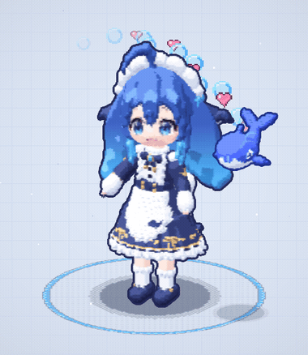 
      <b>7. WHALE（ロゴクジラとじゃれ合い）</b> 
      3D クジラ前後 Z ソート＋ハート＆泡
    </td>
    <td align="center" width="33%">
      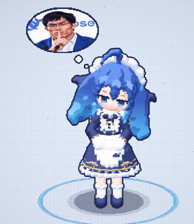 
      <b>6. THINK（CEO 吹き出しミーム）</b> 
      無口ジト目＋頭上の CEO 吹き出し
    </td>
  </tr>
  <tr>
    <td align="center" width="33%">
      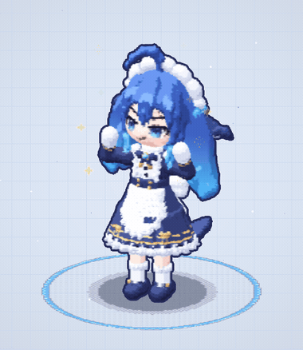 
      <b>5. SHHH（CEO フレックス → シーッ！）</b> 
      ドヤ顔＋指ポーズ＋キラキラ演出
    </td>
    <td align="center" width="33%">
      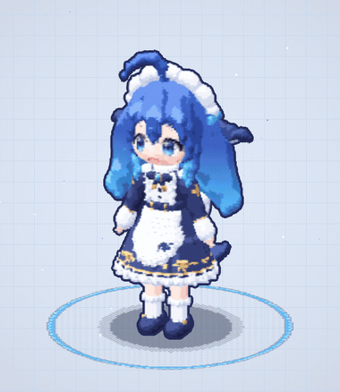 
      <b>8. SPLASH（海洋攻撃①）</b> 
      水色三日月斬撃＋3D 水しぶき＆水紋
    </td>
    <td align="center" width="33%">
      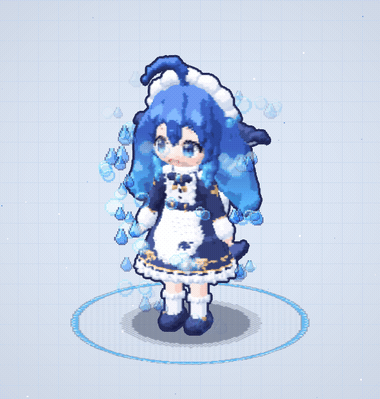 
      <b>9. VORTEX（海洋攻撃②）</b> 
      浮遊チャージ → 深海大渦巻き＋3重水紋
    </td>
  </tr>
</table>

  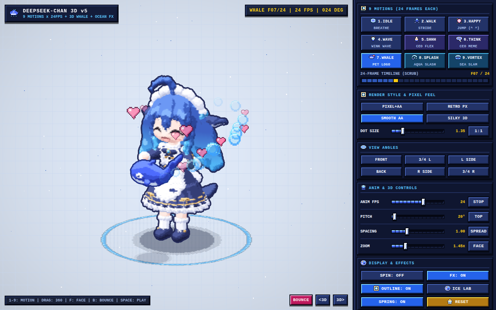

---

## 2. ムキムキ DeepSeek CEO（[`ceo.html`](./ceo.html)）

パワータイプを活かした全 9 モーション（`1. IDLE` / `2. MARCH` / `3. FLEX` / `4. SHHH` / `5. UPPER` / `6. PUNCH` / `7. SMASH` / `8. RUSH` / `9. AURA`）と 5 表情（ニヤリ・メガネ閃光・蒼瞳咆哮・シーッ集中・勝利笑顔）を収録。汎用エンジン [kuraneko1/anime-pseudo-3d](https://github.com/kuraneko1/anime-pseudo-3d) を無改造で駆動しています。

<table>
  <tr>
    <td align="center" width="33%">
      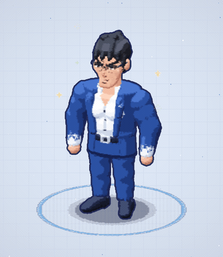 
      <b>3. FLEX（DOUBLE BICEP）</b> 
      上腕二頭筋パンプ振動＋勝利笑顔＆輝き
    </td>
    <td align="center" width="33%">
      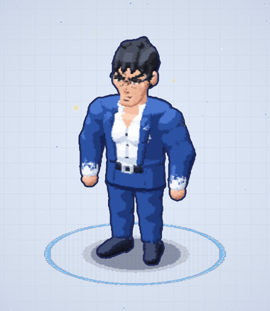 
      <b>4. SHHH（MEWING CEO）</b> 
      口元に立てた人差し指＋メガネ閃光
    </td>
    <td align="center" width="33%">
      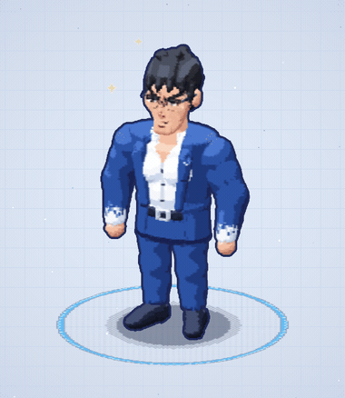 
      <b>5. UPPER（パワー攻撃①）</b> 
      蒼瞳咆哮＋跳躍昇龍アッパー＆二重衝撃波
    </td>
  </tr>
  <tr>
    <td align="center" width="33%">
      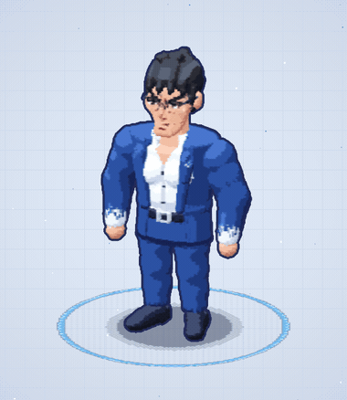 
      <b>6. PUNCH（パワー攻撃②）</b> 
      深く溜めた重ストレート＋ソニック斬撃＆飛沫
    </td>
    <td align="center" width="33%">
      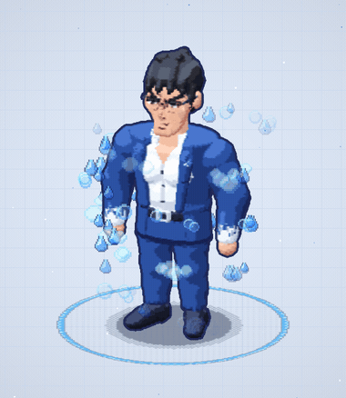 
      <b>7. SMASH（パワー攻撃③）</b> 
      跳躍メテオ叩きつけ＋3連地震リング＆噴出渦
    </td>
    <td align="center" width="33%">
      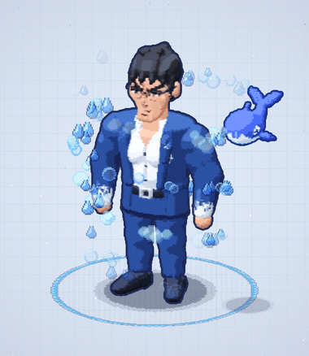 
      <b>9. AURA（DEEPSEEK BOSS）</b> 
      3D クジラロゴ周回（Zソート）＋112粒オーラ渦
    </td>
  </tr>
</table>

  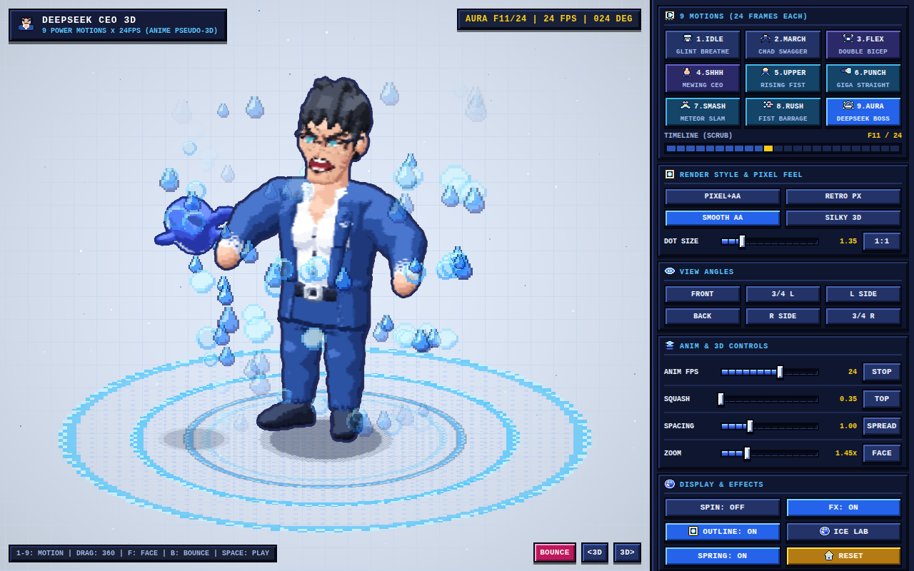

---

## 簡単な使い方

### 開き方
1. このリポジトリをクローン、または [`index.html`](./index.html)（DeepSeek ちゃん）／[`ceo.html`](./ceo.html)（ムキムキ CEO）をダウンロードします。
2. Chrome / Edge / Firefox / Safari などのモダンブラウザで開くだけです（`file://` 直開き対応・通信ゼロ）。

### 操作方法

| 操作 | 内容 |
| :--- | :--- |
| **左ドラッグ / スワイプ** | 360° 自由回転（自動回転を一時停止） |
| **マウスホイール** | ズームイン／アウト |
| **キーボード `1` 〜 `9`** | 全 9 モーション切替 • DeepSeek ちゃん: `IDLE` / `WALK` / `HAPPY` / `WAVE` / `SHHH` / `THINK` / `WHALE` / `SPLASH` / `VORTEX` • ムキムキ CEO: `IDLE` / `MARCH` / `FLEX` / `SHHH` / `UPPER` / `PUNCH` / `SMASH` / `RUSH` / `AURA` |
| **`Space`** | アニメーション再生／一時停止 |
| **24-FRAME TIMELINE** | タイムラインをドラッグして好きな 1 コマで固定＆360° 回転鑑賞（水しぶき・衝撃波・周回クジラも静止観察可能） |
| **`F` キー / `FACE` ボタン** | 表情が見やすい顔アップ視点へ切替 |
| **`B` キー / `BOUNCE` ボタン** | 弾性バウンス（スクワッシュ＆ストレッチ） |
| **`Q` / `E` または `←` / `→`** | 左右へ連続回転 |
| **`R` キー / `RESET` ボタン** | 初期状態（`SQUASH 0.35` / `ICE LAB` / `SMOOTH AA`）へリセット |

### 主な表示カスタマイズ（右パネル）
- **RENDER STYLE**: `SMOOTH AA`（デフォルト）／`PIXEL+AA`（ピクセル粒感＋境界 AA）／`RETRO PX`（王道ドット絵）／`SILKY 3D`（フィギュア風滑らか）＋ `DOT SIZE` 調整
- **3D コントロール**: `ANIM FPS` (6〜36 FPS) / `SQUASH`（俯瞰角度 `0.35`〜`1.00`、`TOP` 真上視点） / `SPACING`（`SPREAD` で 160 スライス層を展開観察） / `ZOOM`
- **背景・演出**: `ICE LAB` / `DEEP SEA` / `MIDNIGHT` の 3 テーマ、`FX: ON/OFF`、`OUTLINE: ON/OFF`、`SPRING: ON/OFF`

---

## 使用している疑似 3D エンジン・スキル & クレジット

本作品の WebGL 2-Pass 描画エンジンおよびアニメ調 24 FPS 疑似 3D 制作手法は、キャラクター非依存の汎用スキル＆エンジンとして別リポジトリに分離・公開しています（[`ceo.html`](./ceo.html) はこのエンジンを無改造で使用した実作モデルです）。

- **Anime Pseudo-3D Skill & Engine**: [kuraneko1/anime-pseudo-3d](https://github.com/kuraneko1/anime-pseudo-3d)
- **Credits & Inspiration**: 本作品のスプライトスタッキング（積層スライスによる疑似 3D ピクセルアート）の発想と基礎手法は、**[SpriteCook — Sprite stacking for fake 3D pixel art cars and props](https://www.spritecook.ai/blog/sprite-stacking-pixel-art)** から多大なる影響を受けています。また汎用基盤として [kuraneko1/sprite-stacking-3d](https://github.com/kuraneko1/sprite-stacking-3d) の知見を活用しています。

---

## License

[MIT License](./LICENSE)
