

# DeepSeek-chan 3D Viewer

**DeepSeek 娘（鲸鱼女仆）＆ 肌肉版 DeepSeek CEO（力量型）**  
360° 自由旋转 · 24 FPS 伪 3D（精灵堆叠 / Sprite Stacking）WebGL 交互式预览器

  
  
  
  
  

  <a href="./README.md">🇯🇵 日本語</a> &nbsp;|&nbsp;
  <a href="./README.en.md">🇺🇸 English</a> &nbsp;|&nbsp;
  <b>🇨🇳 简体中文</b>

---

两位角色均已打包为**零依赖单文件 HTML**，完整内嵌 **9 组动作 × 24 帧（共 216 帧）**、多套动漫表情、支持相机角度深度 Z 排序的 **3D 体素 DeepSeek 鲸鱼 Logo 伙伴** 以及 3D 粒子特效。无需服务器或安装任何环境，下载后直接用浏览器双击即可运行。

| 角色 | 单文件 HTML（支持 `file://` 直接打开） | 收录内容 |
| :--- | :--- | :--- |
| **DeepSeek 娘（鲸鱼女仆）** | [`index.html`](./index.html) | 9 动作 × 24 FPS（共 216 帧）· 9 种表情 · 3D 鲸鱼互动 · CEO 气泡梗 · 海洋水系特效 |
| **肌肉版 DeepSeek CEO（力量型）** | [`ceo.html`](./ceo.html) | 力量特化 9 动作 × 24 FPS（共 216 帧）· 5 种表情 · 3D 环绕鲸鱼 Logo · 冲击波与流星砸地特效 |

---

## 1. DeepSeek 娘（[`index.html`](./index.html)）

<table>
  <tr>
    <td align="center" width="33%">
      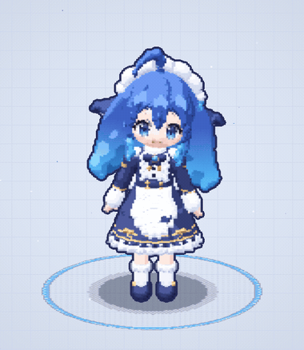 
      <b>360° 旋转（1. IDLE）</b> 
      全角度无闪烁丝滑 WebGL 渲染
    </td>
    <td align="center" width="33%">
      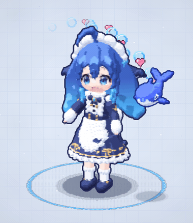 
      <b>7. WHALE（鲸鱼 Logo 玩耍）</b> 
      3D 鲸鱼前后 Z 排序＋爱心与气泡轨迹
    </td>
    <td align="center" width="33%">
      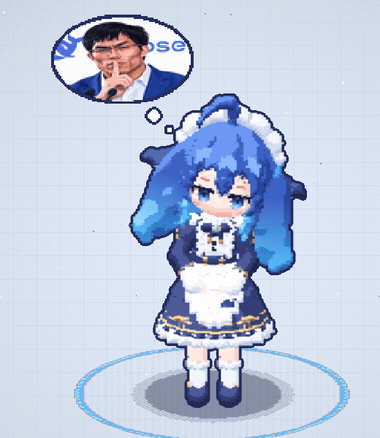 
      <b>6. THINK（CEO 气泡梗）</b> 
      淡定死鱼眼＋头顶浮现 CEO 思考气泡
    </td>
  </tr>
  <tr>
    <td align="center" width="33%">
      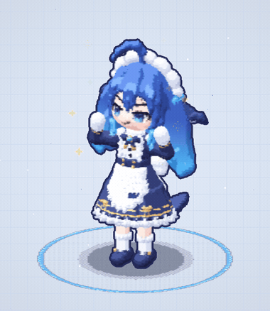 
      <b>5. SHHH（秀肌肉 → 嘘！）</b> 
      得意笑＋竖指手势＋闪光星尘
    </td>
    <td align="center" width="33%">
      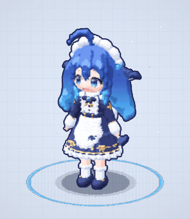 
      <b>8. SPLASH（海洋攻击①）</b> 
      冰蓝新月斩击＋3D 飞溅水花与地面水纹
    </td>
    <td align="center" width="33%">
      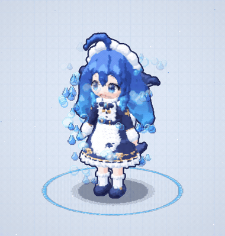 
      <b>9. VORTEX（海洋攻击②）</b> 
      浮空蓄力 → 深海大漩涡＋三重水纹扩散
    </td>
  </tr>
</table>

  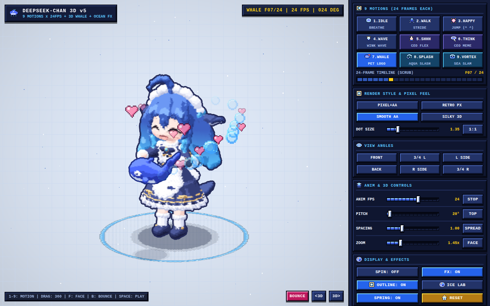

---

## 2. 肌肉版 DeepSeek CEO（[`ceo.html`](./ceo.html)）

完整收录发挥力量型特色的 9 组动作（`1. IDLE` / `2. MARCH` / `3. FLEX` / `4. SHHH` / `5. UPPER` / `6. PUNCH` / `7. SMASH` / `8. RUSH` / `9. AURA`）与 5 套表情（邪魅一笑、眼镜反光、苍瞳怒吼、嘘手势专注、自信露齿笑）。直接基于 [kuraneko1/anime-pseudo-3d](https://github.com/kuraneko1/anime-pseudo-3d/blob/main/README.zh-CN.md) 角色无关通用引擎零改动驱动。

<table>
  <tr>
    <td align="center" width="33%">
      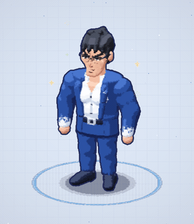 
      <b>3. FLEX（DOUBLE BICEP）</b> 
      双肱二头肌发力震颤＋自信笑容与金光
    </td>
    <td align="center" width="33%">
      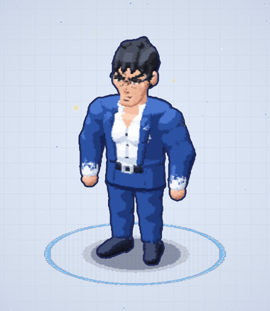 
      <b>4. SHHH（MEWING CEO）</b> 
      还原梗图嘴前竖起食指＋二次元眼镜反光
    </td>
    <td align="center" width="33%">
      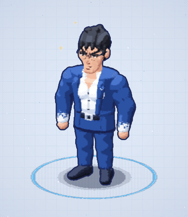 
      <b>5. UPPER（力量攻击①）</b> 
      苍瞳咆哮＋腾空升龙上勾拳与双重冲击波
    </td>
  </tr>
  <tr>
    <td align="center" width="33%">
      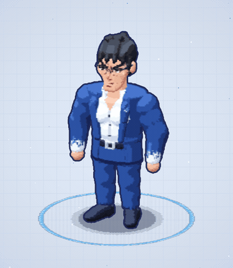 
      <b>6. PUNCH（力量攻击②）</b> 
      蓄力踏步重直拳＋音爆斩光与 3D 飞沫
    </td>
    <td align="center" width="33%">
      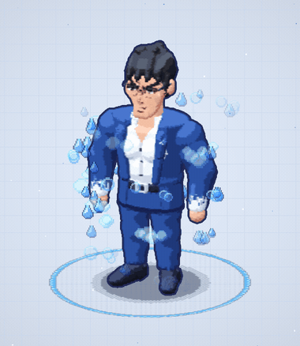 
      <b>7. SMASH（力量攻击③）</b> 
      跃起双手砸地＋三重地震波与喷涌能量漩涡
    </td>
    <td align="center" width="33%">
      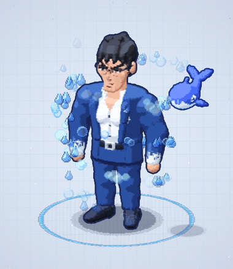 
      <b>9. AURA（DEEPSEEK BOSS）</b> 
      3D 鲸鱼 Logo 环绕（深度 Z 排序）＋112 粒气场漩涡
    </td>
  </tr>
</table>

  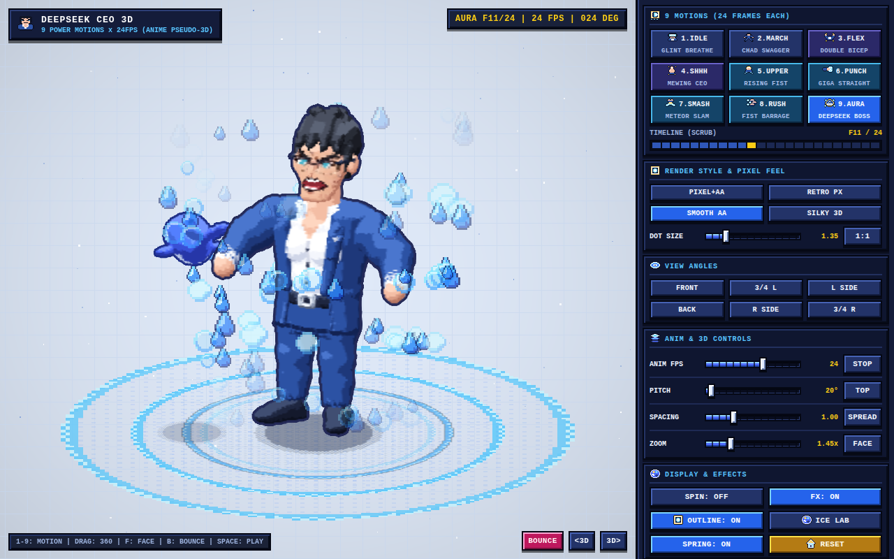

---

## 快速上手

### 打开方式
1. 克隆本仓库，或单独下载 [`index.html`](./index.html)（DeepSeek 娘）／[`ceo.html`](./ceo.html)（肌肉版 CEO）。
2. 直接使用 Chrome / Edge / Firefox / Safari 等现代浏览器双击打开即可（支持 `file://` 本地离线运行，零网络请求）。

### 交互操作

| 操作方式 | 功能说明 |
| :--- | :--- |
| **鼠标左键拖拽 / 触屏滑动** | 360° 自由旋转视角（自动暂停旋转） |
| **鼠标滚轮** | 缩放画面 |
| **数字键 `1` ～ `9`** | 切换全部 9 组动作 • DeepSeek 娘：`IDLE` / `WALK` / `HAPPY` / `WAVE` / `SHHH` / `THINK` / `WHALE` / `SPLASH` / `VORTEX` • 肌肉版 CEO：`IDLE` / `MARCH` / `FLEX` / `SHHH` / `UPPER` / `PUNCH` / `SMASH` / `RUSH` / `AURA` |
| **`Space` 空格键** | 播放 / 暂停动画 |
| **24 帧时间轴** | 拖拽或点击任意帧定格「子弹时间」，360° 环绕欣赏水花、冲击波与 3D 环绕鲸鱼 |
| **`F` 键 / `FACE` 按钮** | 切换至面部特写视角观察表情细节 |
| **`B` 键 / `BOUNCE` 按钮** | 触发弹性挤压拉伸（Squash & Stretch）弹跳 |
| **`Q` / `E` 或 `←` / `→`** | 平滑左右连续旋转 |
| **`R` 键 / `RESET` 按钮** | 重置为默认观感（`PITCH 20°` / `ICE LAB` / `SMOOTH AA`） |

### 画面自定义（右侧控制面板）
- **RENDER STYLE（质感模式）**：`SMOOTH AA`（默认丝滑抗锯齿）／`PIXEL+AA`（像素颗粒感＋边缘抗锯齿）／`RETRO PX`（经典硬边复古像素）／`SILKY 3D`（手办级柔滑曲面），并支持调节 `DOT SIZE`
- **3D 相机与层叠参数**：`ANIM FPS`（6～36 FPS 变速）/ `PITCH`（真 3D 俯仰角 `15°`～`90°`，`TOP` 真俯视）/ `SPACING`（点击 `SPREAD` 可展开观察全部 160 层切片）/ `ZOOM`
- **背景主题与开关**：`ICE LAB` / `DEEP SEA` / `MIDNIGHT` 三套场景主题，`FX: ON/OFF`、`OUTLINE: ON/OFF`、`SPRING: ON/OFF`

---

## 底层伪 3D 引擎、技能库与致谢

本作品背后的角色无关 WebGL 2-Pass 渲染引擎与 24 FPS 动漫风伪 3D 制作工具链，已独立开源发布于专用仓库（[`ceo.html`](./ceo.html) 即为直接调用未修改引擎的实装范例）：

- **Anime Pseudo-3D 技能与引擎仓库**：[kuraneko1/anime-pseudo-3d](https://github.com/kuraneko1/anime-pseudo-3d/blob/main/README.zh-CN.md)
- **致谢与灵感来源（Credits & Inspiration）**：本作品所采用的精灵堆叠（Sprite Stacking，通过多层 2D 切片构建伪 3D 像素艺术）核心思路与基础方法深受 **[SpriteCook — Sprite stacking for fake 3D pixel art cars and props](https://www.spritecook.ai/blog/sprite-stacking-pixel-art)** 启发，同时参考了通用工具库 [kuraneko1/sprite-stacking-3d](https://github.com/kuraneko1/sprite-stacking-3d) 的实践经验。

---

## License

[MIT License](./LICENSE)
